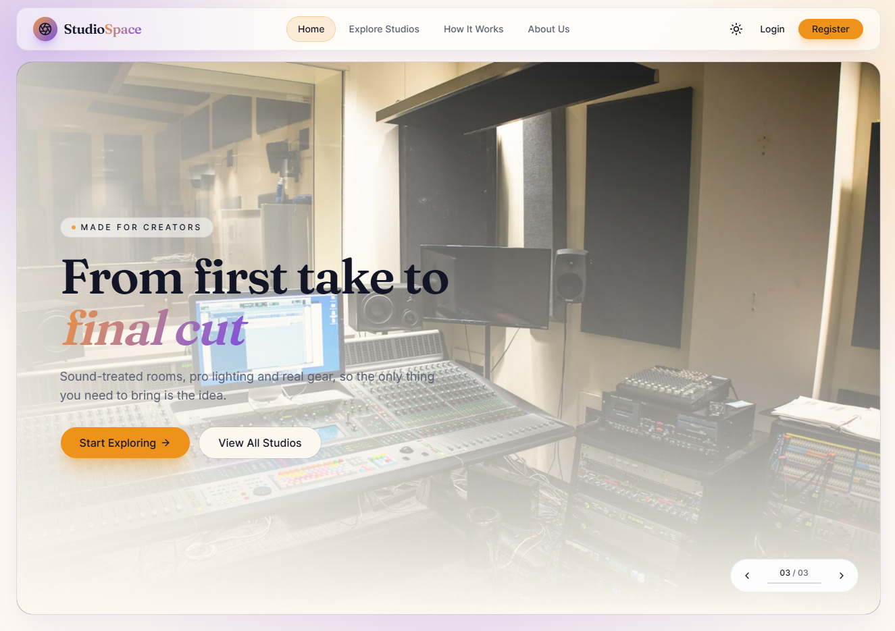
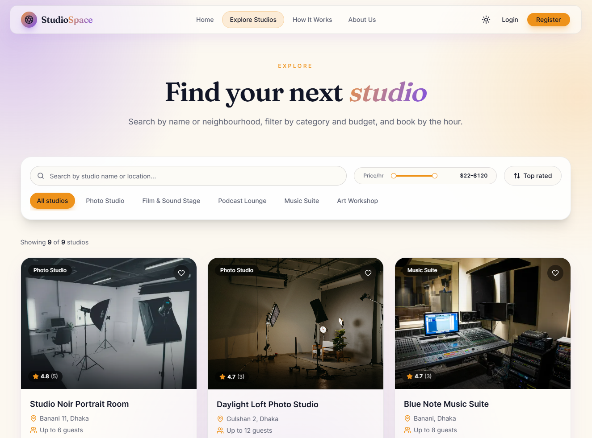
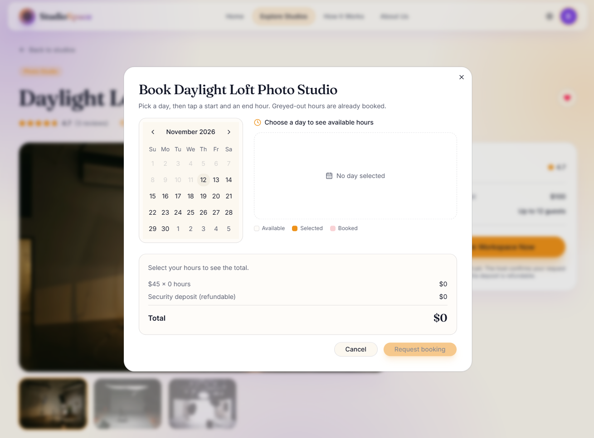
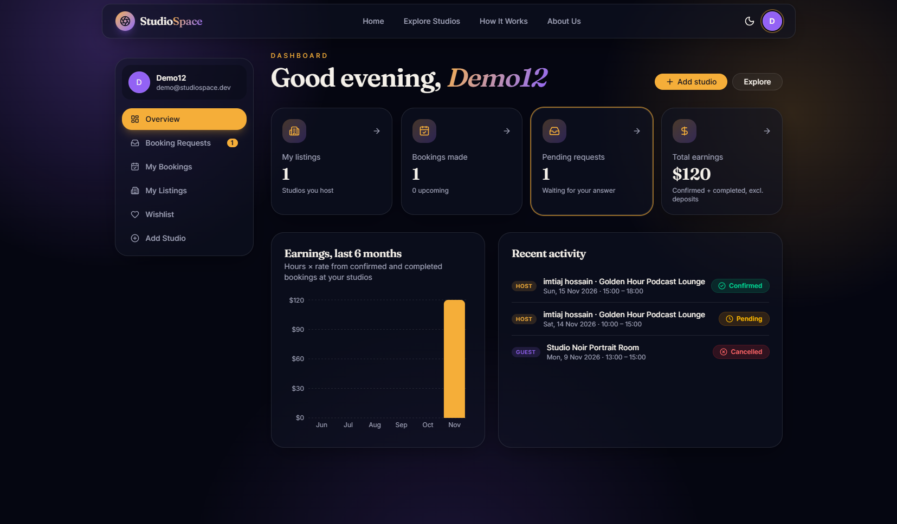
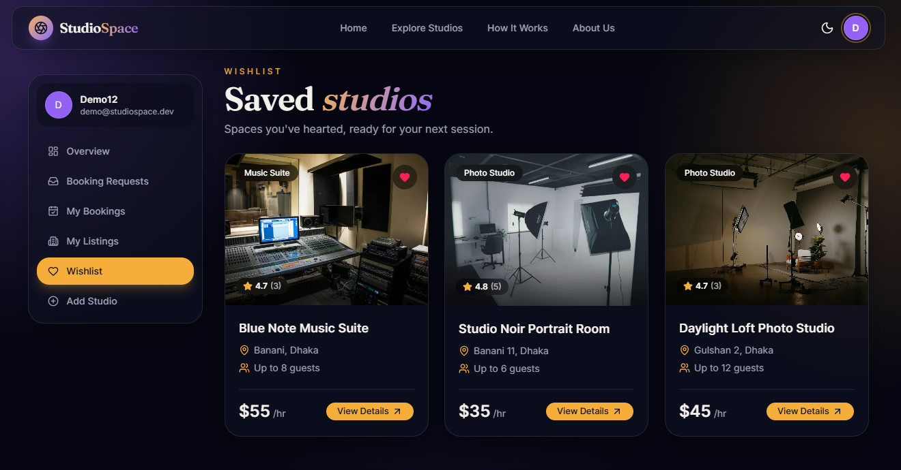

# 🎬 StudioSpace



A peer-to-peer marketplace where hosts list professional creative spaces (photo studios, film & sound stages, podcast lounges, music suites and art workshops) and creators book them by the hour.

**🔗 Live site:** https://studiospace-client-lovat.vercel.app
**🔗 API:** https://studiospace-server-sepia.vercel.app
**📦 Server repo:** https://github.com/Istiak0614/studiospace-server

---

## 🔑 Test Credentials

| Email | Password |
|---|---|
| demo@studiospace.dev | Demo1234 |

The demo account hosts a studio (with a pending request to confirm), has bookings and has saved studios. You can also sign in with Google.

---

## 🛠️ Tech Stack

| Area | Technologies |
|---|---|
| Framework | Next.js 16 (App Router), React 19, TypeScript |
| Styling & UI | Tailwind CSS v4, shadcn/ui, Motion (Framer Motion), Swiper |
| Auth | BetterAuth (email/password + Google), JWT in an HTTPOnly cookie |
| Data & Charts | Recharts, date-fns, react-day-picker |
| Other | jsPDF (invoices), imgbb (image hosting), Sonner (toasts) |
| Backend | Express 5 + MongoDB ([studiospace-server](https://github.com/Istiak0614/studiospace-server)) |
| Hosting | Vercel |

---

## ✨ Key Features

- **Explore & filter:** search by title or location, category chips, a price-range slider, four sort orders and pagination. Filters live in the URL, so reloads and shared links keep them.
- **Live availability booking:** a calendar modal with hour chips. Hours already confirmed are greyed out, and a live price breakdown shows hours × rate + refundable deposit.
- **Double-booking prevention:** a request can't overlap a confirmed booking, and confirming a slot automatically declines overlapping requests.
- **Host dashboard:** animated stats, a 6-month earnings chart, recent activity and a Booking Requests inbox to confirm or decline.
- **Full listing management:** add a studio with drag-and-drop multi-image upload, edit it, or delete it through a confirmation modal.
- **Booking lifecycle:** Pending → Confirmed → Completed with colour-coded badges, cancel-while-pending and a downloadable **PDF invoice**.
- **Reviews & wishlist:** star reviews from completed bookings only, and a heart button to save any studio.
- **Secure auth:** private routes are checked on the server, so reloading never logs you out.
- **Light & dark themes:** a glassmorphism "Midnight Studio" design across the whole app.

---

## 📸 Screenshots

| Explore studios | Booking calendar |
|---|---|
|  |  |

| Host dashboard | Dark mode |
|---|---|
|  |  |

---

## 📦 Dependencies

**Main dependencies**

```text
next             16.4.5     react / react-dom   19.3.0
better-auth      ^1.7.18    motion              ^14.9.1
recharts         ^3.10.1    swiper              ^14.4.0
jspdf            ^4.2.1     sonner              ^2.0.8
date-fns         ^4.4.0     react-day-picker    ^10.0.2
next-themes      ^0.4.6     lucide-react        ^1.69.0
@base-ui/react   ^1.9.0     class-variance-authority ^0.7.1
```

**Dev dependencies**

```text
typescript ^5 · tailwindcss ^4.3.4 · @tailwindcss/postcss · eslint ^9 · eslint-config-next 16.4.5
```

See [`package.json`](./package.json) for the full list.

---

## 🚀 Run Locally

**Prerequisites:** Node.js 20+ and npm. The [server](https://github.com/Istiak0614/studiospace-server) must be running on port 5000.

1. **Clone the repository**
   ```bash
   git clone https://github.com/Istiak0614/studiospace-client.git
   cd studiospace-client
   ```

2. **Install dependencies**
   ```bash
   npm install
   ```

3. **Set up environment variables**
   ```bash
   cp .env.example .env.local
   ```

   | Variable | Description |
   |---|---|
   | `API_URL` | Express server URL (`http://localhost:5000` locally) |
   | `NEXT_PUBLIC_IMGBB_KEY` | imgbb API key for image uploads ([get one free](https://api.imgbb.com/)) |

4. **Start the development server**
   ```bash
   npm run dev
   ```

5. Open **http://localhost:3000**

---

## 🧩 How It Fits Together

All `/api/*` requests are proxied to the Express server through a Next.js rewrite, so the browser only talks to one domain and auth cookies stay first-party. `proxy.ts` checks the session cookie on the server before rendering private pages (`/add-studio`, `/my-listings`, `/my-bookings`, `/studios/edit/*`, `/dashboard/*`).

**Booking rules**
- Studios are bookable in whole hours between 08:00 and 22:00, for 1–12 hours per booking.
- Dashboard earnings are hours × rate. Deposits are refundable and not counted as income.

---

## 🔗 Links

- **Live site:** https://studiospace-client-lovat.vercel.app
- **Live API:** https://studiospace-server-sepia.vercel.app
- **Server repo:** https://github.com/Istiak0614/studiospace-server
- **Author:** [Md. Istiak Hossain Ifti](https://www.linkedin.com/in/md-istiak-hossain-ifti/)
